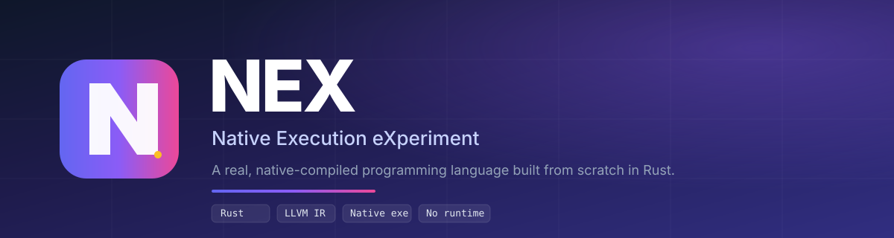
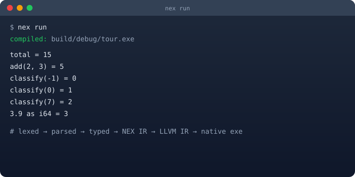

<div align="center">


# NEX

**N**ative **E**xecution e**X**periment — a real, native-compiled programming language built from scratch in Rust.

[](https://github.com/cokovali10-sketch/NEX/actions/workflows/ci.yml)
[](LICENSE)
[](https://www.rust-lang.org/)
[](https://llvm.org/)
[](#status)
[](https://github.com/cokovali10-sketch/NEX/releases)

*Readable syntax. Real native code. No interpreter. No VM.*

</div>



NEX is an experimental native compiled programming language and developer ecosystem.
The long-term goal is a readable, statically typed language with native performance,
a safe memory model, an LLVM-based compiler, a standard library, universal
interoperability, and a professional toolchain.

## Why NEX?

| | |
|---|---|
| **Native** | Compiles to a real Windows executable via LLVM IR + Clang. No bytecode, no interpreter, no VM. |
| **Honest** | Every supported feature has tests. No fake benchmarks, no vaporware. |
| **Readable** | Python-style indentation, static typing, clear error codes (`NXS007`, `NXP010`...). |
| **Small core** | Std-only Rust workspace, minimal supply chain, no hidden dependencies. |
| **Growing** | Structs, enums, arrays, tuples, modules, match — all working today. |

The NEX core is intentionally small, but it is a real vertical slice: `.nex`
source is lexed, parsed, type-checked, lowered to NEX IR, emitted as LLVM IR, and
compiled to a native executable with Clang. The compiler is written in Rust with
no third-party crates. Generated programs are linked against a small, readable C
runtime (`runtime/core/nex_rt.c`) — not a hidden language runtime.

## Status

- Current milestone: **NEX 0.2 — Semantic Core**.
- Implemented: lexer, parser, AST, semantic analysis, type checking, NEX IR,
  LLVM textual IR backend, native executable generation, CLI, and end-to-end
  tests.
- Implemented in the language: functions, bindings, `if`/`elif`/`else`,
  `while`, `for`, `const`, explicit casts, string equality and ordering,
  compound assignment, structs with scalar or nested struct fields and
  function parameters and returns, enums with `match`, arrays and tuples with
  type annotations and function parameters and returns, printing,
  constants, equality for aggregate values, and external C calls, tuples, and modules with `use`
  aliases.
- Not implemented yet: generics, traits, the full standard library, package
  manager, debugger, profiler, and NEX Studio.
- Platform support today: Windows x86-64 with Clang. The compiler is designed to
  target other platforms, but only the host platform is tested.

## Quick start

Build the toolchain:

```powershell
cargo build
```

Create and run a program:

```powershell
cargo run -p nex-cli -- new hello
cd hello
cargo run -p nex-cli -- run
```

Compile a single file directly:

```powershell
cargo run -p nex-driver --bin nexc -- examples/hello/src/main.nex --emit exe -o hello.exe
./hello.exe
```

Run tests:

```powershell
cargo test --workspace
```

Check the toolchain:

```powershell
cargo run -p nex-cli -- doctor
```

## See it run



## Example

```nex
fn add(a: i64, b: i64) -> i64:
    return a + b

fn main():
    var total = 0
    var i = 1
    while i <= 5:
        total = total + i
        i = i + 1
    print(total)
    print(add(2, 3))
```

## Repository layout

```text
NEX/
  compiler/      Rust crates: diagnostics, lexer, parser, AST, semantic, IR, backend, driver
  runtime/       Small C runtime used by generated programs
  tools/cli/     The `nex` command-line interface
  tests/         Unit and end-to-end tests
  examples/      Example NEX projects
  docs/          User and developer documentation
  specs/         Language and compiler specifications
  studio/        Reserved for NEX Studio
```

## Documentation

- [Architecture](ARCHITECTURE.md)
- [Roadmap](ROADMAP.md)
- [Changelog](CHANGELOG.md)
- [Contributing](CONTRIBUTING.md)
- [Security](SECURITY.md)
- [Language specification](specs/language.md)
- [Grammar](specs/grammar.md)
- [Type system](specs/types.md)
- [Memory model](specs/memory-model.md)
- [Compiler architecture](specs/compiler.md)

## Design principles

- Write simple programs.
- Compile to native code.
- Keep the compiler honest: every supported feature has tests.
- Do not claim performance or compatibility without measurements.
- Do not hide language complexity behind unpredictable rules.

## Contributing

NEX is early and moving quickly. Issues, design discussions, and pull requests
are welcome — see [CONTRIBUTING.md](CONTRIBUTING.md) for the workflow and
[ROADMAP.md](ROADMAP.md) for what is next.

## License

MIT © 2026 NEX Engineering. See [LICENSE](LICENSE).
