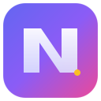

<div align="center">



# NEX

**N**ative **E**xecution e**X**periment — a real, native-compiled programming language built from scratch in Rust.

[](https://github.com/cokovali10-sketch/NEX/actions/workflows/ci.yml)
[](LICENSE)
[](https://www.rust-lang.org/)
[](https://llvm.org/)
[](#status)
[](https://github.com/cokovali10-sketch/NEX/releases)

*Readable syntax. Real native code. No interpreter. No VM.*

</div>


NEX is an experimental native compiled programming language and developer ecosystem.
The long-term goal is a readable, statically typed language with native performance,
a safe memory model, an LLVM-based compiler, a standard library, universal
interoperability, and a professional toolchain.

## Why NEX?

| | |
|---|---|
| **Native** | Compiles to a real native executable via LLVM IR + Clang. No bytecode, no interpreter, no VM. |
| **Honest** | The integration suite covers the compiler end to end; known gaps are documented, not hidden. |
| **Readable** | Python-style indentation, static typing, clear error codes (`NXS007`, `NXP010`...). |
| **Small core** | Std-only Rust workspace, minimal supply chain, no hidden dependencies. |
| **Growing** | Structs, enums, arrays, tuples, modules, match — all working today. |

The NEX core is intentionally small, but it is a real vertical slice: `.nex`
source is lexed, parsed, type-checked, lowered to NEX IR, emitted as LLVM IR, and
compiled to a native executable with Clang. The compiler is written in Rust with
no third-party crates. Generated programs are linked against a small, readable C
runtime (`runtime/core/nex_rt.c`) — not a hidden language runtime.

## Status

- Current release: **NEX 1.0.1 - Stable Core** (first published binaries for
  Windows and Linux; supersedes the asset-less `v1.0.0` tag).
- Implemented: lexer, parser, AST, semantic analysis, type checking, NEX IR,
  LLVM textual IR backend, native executable generation, CLI, and end-to-end
  tests.
- Implemented in the language: functions, bindings, `if`/`elif`/`else`,
  `while`, `for` ranges and `for x in array`, `const`, explicit casts, string
  equality and ordering, compound and parallel assignment, structs with scalar
  or nested struct fields and function parameters and returns, enums with
  `match`, arrays (fixed and growable `[T]`, including struct and tuple elements)
  and tuples with type annotations
  and function parameters and returns, traits and inherent `impl` methods with
  static dispatch, generics via monomorphization (including type annotations
  such as `Box<i64>`), type aliases, modules and
  file imports, f-strings, string indexing/slicing, bitwise operators,
  `unsafe:` blocks, external C calls, error propagation with `?`, `defer`, and printing.
- Runtime: string helpers, files, blocking TCP and HTTP helpers, JSON, maps,
  threads/mutexes, a thread pool, a router, a string builder, time and math
  functions, process environment/arguments, `exit`, and logging (see
  `docs/standard-library.md`).
- Not implemented yet: ownership, borrowing and lifetime checking; async/await;
  the rest of the standard library (general collections, crypto, spawning child
  processes); a package registry; Python and Rust adapters; NEX Studio. `nex lsp` is a built-in
  language server (hover, go-to-definition, completion, document symbols,
  formatting, live diagnostics). `nex debug` and
  `nex profile` build a debug/release executable and run it; they are not a
  full debugger or profiler.
- Platform support: Windows x86-64 is the primary tested host. CI also builds
  and tests on Ubuntu. `--target <triple>` selects a Clang target, but only the
  host platform is validated end to end by the test suite.

## Install

Download the latest archive from
[GitHub Releases](https://github.com/cokovali10-sketch/NEX/releases):

- Windows: `nex-<version>-windows-x86_64.zip`
- Linux: `nex-<version>-linux-x86_64.tar.gz`

Extract the `nex` binary, add it to `PATH`, and run `nex doctor`. Compiling NEX
programs requires Clang in `PATH`; the compiler binary itself does not need
Rust. Every archive ships with a SHA-256 checksum file.

## Quick start

Build the toolchain from source:

```powershell
cargo build
```

Create and run a program:

```powershell
cargo run -p nex-cli -- new hello
cd hello
cargo run -p nex-cli -- run
```

Compile a single file directly:

```powershell
cargo run -p nex-driver --bin nexc -- examples/hello/src/main.nex --emit exe -o hello.exe
./hello.exe
```

Run tests:

```powershell
cargo test --workspace
```

Check the toolchain:

```powershell
cargo run -p nex-cli -- doctor
```

## See it run


## Example

```nex
fn add(a: i64, b: i64) -> i64:
    return a + b

fn main():
    var total = 0
    var i = 1
    while i <= 5:
        total = total + i
        i = i + 1
    print(total)
    print(add(2, 3))
```

## Repository layout

```text
NEX/
  compiler/      Rust crates: diagnostics, lexer, parser, AST, semantic, IR, backend, driver
  runtime/       Small C runtime used by generated programs
  tools/cli/     The `nex` command-line interface
  tests/         Unit and end-to-end tests
  examples/      Example NEX projects
  docs/          User and developer documentation
  specs/         Language and compiler specifications
  studio/        Reserved for NEX Studio
```

## Using NEX from an AI agent

NEX is designed so that any AI (not just humans) can read, write, verify and
ship NEX programs without guessing:

- `docs/for-ai.md` — a single self-contained language reference for agents:
  workflow, syntax, all builtins, error codes, and a full annotated example.
- `AGENTS.md` — repository guide for agents (verification loop, layout,
  honest status).
- `nex check --json` — machine-readable diagnostics for automated fixing.
- `nex lsp` — a Language Server over stdio (hover, go-to-definition,
  completion, document symbols, formatting, live diagnostics).
- `examples/kv_store` — a complete, verified JSON HTTP key-value service for
  ambitious programs.

## Documentation

- [Architecture](ARCHITECTURE.md)
- [Roadmap](ROADMAP.md)
- [Changelog](CHANGELOG.md)
- [Contributing](CONTRIBUTING.md)
- [Security](SECURITY.md)
- [Language specification](specs/language.md)
- [Grammar](specs/grammar.md)
- [Type system](specs/types.md)
- [Memory model](specs/memory-model.md)
- [Compiler architecture](specs/compiler.md)
- [For AI agents](docs/for-ai.md)
- [Language server](docs/language-server.md)

## Design principles

- Write simple programs.
- Compile to native code.
- Keep the compiler honest: supported features are covered by tests, and known
  gaps are listed as limitations.
- Do not claim performance or compatibility without measurements.
- Do not hide language complexity behind unpredictable rules.

## Contributing

NEX is early and moving quickly. Issues, design discussions, and pull requests
are welcome — see [CONTRIBUTING.md](CONTRIBUTING.md) for the workflow and
[ROADMAP.md](ROADMAP.md) for what is next.

## License

MIT © 2026 NEX Engineering. See [LICENSE](LICENSE).
